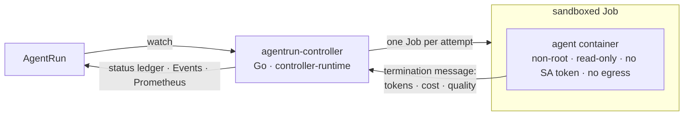
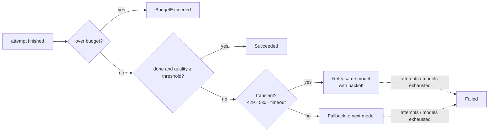

# ⎈ agentrun-operator

**Kubernetes Operators for AI Agents — orchestrating LLMs like we orchestrate Pods.**

Companion code for the talk *Kubernetes Operators for AI Agents* · DevFest Malta 2026 · [Otavio Celestino](https://huncoding.com/en) (GDE, Go).

An `AgentRun` CRD declares the model, the fallback chain, the allowed MCP tools, a token/dollar budget and a timeout. A Go controller (controller-runtime) turns it into **one sandboxed Job per attempt**, meters every token and decides, after each attempt, whether to **succeed, retry, fall back to another model, or pull the kill switch**.

## Run the demo

You need **Docker Desktop with Kubernetes enabled** (Settings → Kubernetes → Enable → *Apply*), `kubectl` and Go 1.26+.

```bash
make stage-check   # once, before the talk: full rehearsal + checklist
make demo          # the live demo
```

That's the whole interface. `make doctor` explains anything that is missing, and `make clean` removes everything from the cluster.

`make demo` tells one story:

> 🚨 **Incident #4211:** the payments API returns 500 after a deploy, and on-call asks AI agents to triage it. Five things go wrong in production; watch the operator handle each one.

| act | what goes wrong | what the operator does |
|---|---|---|
| 1 golden path | nothing | one sandboxed Job, answer scored, `Succeeded` |
| 2 rate limit | the API answers `429` twice | retries the same model with backoff, bounded |
| 3 hallucination | the model invents a `kubectl` flag | the eval scores it 0.33, the quality gate blocks it, falls back to the next model |
| 4 runaway agent | the agent loops on its own context | kill switch at the dollar budget → `BudgetExceeded` |
| 5 broken models | every model returns broken tool calls | gives up after the last model → `Failed`, with a reason |

Acts fire every ~9 s on their own: `space` fires the next one now, `p` pauses, `r` shows the report card, `q` quits. When the story ends, a **report card** compares the naive `agent.py` loop with the operator, using the real numbers from the run. The LLM is a mock (no API key, no network), so the demo is repeatable.

## The API

```yaml
apiVersion: agents.devfest.dev/v1alpha1
kind: AgentRun
metadata:
  name: triage-issue-4211
spec:
  model: gemini-pro-latest
  fallbackModels: [gemini-flash-latest]
  prompt: "Triage GitHub issue 4211"
  tools:
    - mcp: github          # allow-list
    - mcp: k8s-readonly
  budget:
    maxTokens: 200000
    maxCostUSD: "0.50"
  timeout: 10m
  retryPolicy: {maxAttempts: 3, qualityThreshold: 0.7}
```

## How it works



1. **One Job per attempt**, `backoffLimit: 0`. Kubernetes never re-runs an LLM call on its own; retries are a decision, not a reflex.
2. The agent reports `{tokens, cost, quality, answer}` through the **Pod termination message**: no sidecar, no extra network path.
3. After every attempt the controller runs one pure function, [`Decide`](internal/controller/decide.go): **budget first, then quality, then retry vs. fallback**.



## Where it breaks (on purpose)

- **Non-determinism:** the same spec can give different results.
- **No clear desired state:** "a good answer" is not a field; the quality gate is an eval, and evals can be wrong.
- **Variable cost:** the kill switch reacts *after* a chunk of work, so a run can overshoot its budget slightly. Enforce hard limits at the provider too.
- **Side effects:** a tool call cannot be un-called. Retries need idempotency keys on the tool side.
- **This is a demo:** the LLM and the MCP tools are simulated.

## Layout

```
api/v1alpha1/          AgentRun types
cmd/manager/           the controller
cmd/agent/             the workload of every attempt Job (mock LLM)
cmd/agentctl/          the on-stage show
internal/controller/   Reconcile, Decide (pure policy), Job/NetworkPolicy builders, metrics
internal/tui/          the show: story, scoreboard, report card
config/                CRD, RBAC, controller Deployment, scenario samples
hack/                  demo, stage-check, doctor, e2e rehearsal
```

## License

MIT
