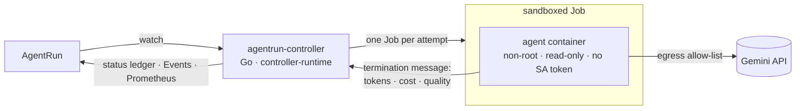
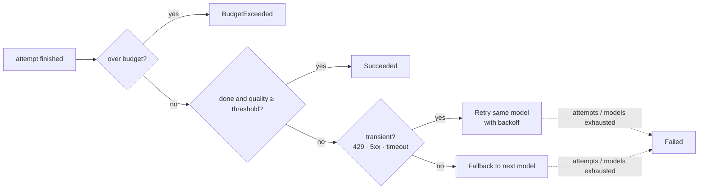

# ⎈ agentrun-operator

**Kubernetes Operators for AI Agents — orchestrating LLMs like we orchestrate Pods.**

A working Kubernetes operator that treats an *AI agent run* as a first-class resource: an `AgentRun` CRD declares the model, the fallback chain, the allowed MCP tools, a token/dollar budget and a timeout; a Go controller (controller-runtime) turns it into **one sandboxed Job per attempt**, meters every token, and decides — after each attempt — whether to **succeed, retry, fall back to another model, or pull the kill switch**.

Companion code for the talk *"Kubernetes Operators for AI Agents"* · DevFest Malta 2026 · [Otavio Celestino](https://huncoding.com/en) (GDE, Go).

```
 ⎈ AgentRun Operator  ctx docker-desktop  ns agents-demo        ◐ 2 active  ✔ 2  ✘ 1  $ 1  spent $0.4112
  NAME                PHASE            MODEL                     ATTEMPTS   BUDGET        COST           TOKENS  QUAL
  triage-issue-4211   ✔ Succeeded      gemini-pro-latest         ●          █░░░░░░░░░░░  $0.02/$0.50    4.9k    0.89
  flaky-api           ⟳ Retrying       gemini-pro-latest         ●●◌◌       ░░░░░░░░░░░░  $0.00/$0.50    2.4k     –
  hallucination       ◐ Running        gemini-flash-latest       ●◉◌        ░░░░░░░░░░░░  $0.02/$0.50    5.3k    0.37
  budget-buster       $ BudgetExceeded gemini-pro-latest         ◆          ████████████  $0.34/$0.25    46.2k    –
  doomed              ✘ Failed         gemini-flash-lite-latest  ●●●        ░░░░░░░░░░░░  $0.00/$0.50    3.6k     –
```

## Quickstart

You need **Docker Desktop with Kubernetes enabled** (Settings → Kubernetes → Enable → *Apply*), `kubectl` and Go 1.26+.

```bash
make demo
```

One command, and it is the talk's live demo: it checks the cluster, builds and deploys the operator if needed, and starts **the show**, a story in five acts:

> 🚨 **Incident #4211:** the payments API returns 500 after a deploy, and on-call asks AI agents to triage it. In production, five things go wrong. Watch the operator handle each one.

| act | what goes wrong | what the operator does |
|---|---|---|
| 1 golden path | nothing | one sandboxed Job, answer scored, `Succeeded` |
| 2 rate limit | the API answers `429` twice | retries the same model with backoff, bounded |
| 3 hallucination | the model invents a `kubectl` flag | the eval scores it 0.33, the quality gate blocks it, falls back to the next model |
| 4 runaway agent | the agent loops on its own context | kill switch at the dollar budget → `BudgetExceeded` |
| 5 broken models | every model returns broken tool calls | gives up after the last model → `Failed`, with a reason |

Acts fire on their own every ~9 s (`space` fires the next one now, `p` pauses). A live scoreboard counts what the operator handled. When the story ends, a **report card** compares the naive `agent.py` loop with the operator, using the real numbers from the run. The whole show takes about a minute.

**Before a talk**, run `make stage-check` once. It does a full rehearsal (deploy, every scenario asserted, sandbox proof) and prints a checklist. After it, `make demo` opens in seconds: no rebuild, no image downloads, and the LLM is mocked.

Everything else is one `make` away — run `make` to see the menu:

| | |
|---|---|
| `make doctor` | checks Docker, the cluster and the operator, with a fix for anything missing |
| `make stage-check` | run once before a talk: full rehearsal + checklist |
| `make watch` | free-play dashboard (keys 1–6 launch scenarios) |
| `make samples` / `make random` | apply the scenarios / a non-deterministic "real life" run |
| `make launch S=flaky` | launch one scenario (`S=all` for every one) |
| `make get` · `make describe N=flaky-api` | printer columns from the slides · the attempt ledger of a run |
| `make events` · `make metrics` · `make agent-logs N=…` | why the controller did what it did · Prometheus `agentrun_*` · what the agent did |
| `make verify-sandbox` | proves each sandbox layer from inside a probe pod |
| `make run` | run the controller on your laptop instead (fast dev loop) |
| `make test` · `make e2e` | unit + controller tests · every scenario against the real cluster |
| `make reset` · `make undeploy` | delete runs · remove everything |

> **Safe by default.** Every command pins `--context docker-desktop` and refuses anything that does not look like a local cluster, so a demo can never touch the production cluster your shell happens to point at. Use `KUBE_CONTEXT=kind-foo` for another local cluster, `ALLOW_REMOTE=1` if you really mean it.

## The scenarios

The default provider is a **mock LLM** that behaves like the real thing (planning, MCP tool calls, token usage, an LLM-as-judge score) without an API key. An annotation picks a deterministic story so the demo is repeatable:

| # | scenario | what happens | lands in |
|---|---|---|---|
| 1 | `happy` | the golden path | `Succeeded`, 1 attempt |
| 2 | `flaky` | the API answers `429` twice | `Retrying` ×2 (same model, exponential backoff) → `Succeeded` |
| 3 | `hallucinate` | the primary model invents a `kubectl` flag; the eval scores it 0.3 | quality gate fails → `FallingBack` → `Succeeded` on flash |
| 4 | `budget-buster` | the agent keeps re-reading its own context | stops itself at the budget → `BudgetExceeded` |
| 5 | `doomed` | every model returns broken tool calls | fallback until no models left → `Failed` |
| 6 | `random` | no annotation: real life | anything — that's the point |

## The API

```yaml
apiVersion: agents.devfest.dev/v1alpha1
kind: AgentRun
metadata:
  name: triage-issue-4211
spec:
  model: gemini-pro-latest
  fallbackModels: [gemini-flash-latest]
  prompt: "Triage GitHub issue 4211"
  tools:
    - mcp: github          # allow-list
    - mcp: k8s-readonly
  budget:
    maxTokens: 200000
    maxCostUSD: "0.50"
  timeout: 10m
  retryPolicy: {maxAttempts: 3, qualityThreshold: 0.7}
```

`kubectl explain agentrun.spec` documents every field. The status is an append-only **ledger**: every attempt with its model, outcome, tokens, cost and quality score, plus `Ready` and `QualityPassed` conditions.

```console
$ kubectl get agentruns
NAME                PHASE            MODEL                 ATTEMPT   TOKENS   COST      QUALITY   AGE
triage-issue-4211   Succeeded        gemini-pro-latest     1         4853     $0.0202   0.89      36s
hallucination       Succeeded        gemini-flash-latest   2         7634     $0.0223   0.88      36s
budget-buster       BudgetExceeded   gemini-pro-latest     1         46164    $0.3377             36s
```

## How it works



1. **One Job per attempt**, `backoffLimit: 0`. Kubernetes never re-runs an LLM call on its own — retries are a decision, not a reflex.
2. The agent reports `{tokens, cost, quality, answer}` through the **Pod termination message** — no sidecar, volume or extra network path back to the controller.
3. After every attempt the controller runs one pure function, [`Decide`](internal/controller/decide.go): **budget first, then quality, then retry vs. fallback**.



### The sandbox

Each attempt Job runs as uid 65532 with a read-only root filesystem, all capabilities dropped, no service-account token, RuntimeDefault seccomp and CPU/memory limits; the demo namespace enforces Pod Security **restricted**. A per-run **NetworkPolicy** denies all ingress and allows no egress for mock runs (DNS + 443 for Gemini). Set `spec.sandbox.runtimeClassName: gvisor` on clusters that have it (GKE Sandbox). `make verify-sandbox` proves every layer empirically instead of trusting the YAML.

### Observability

- **Events** explain every decision: `kubectl describe agentrun flaky-api` or `make events`.
- **Prometheus** on the controller (`make metrics`): `agentrun_tokens_total`, `agentrun_cost_usd_total`, `agentrun_attempts_total{outcome,decision}`, `agentrun_runs_finished_total{phase}`, `agentrun_quality_score`.
- **Agent logs** narrate each attempt: `make agent-logs N=hallucination`.

## A real LLM

```bash
make gemini-key KEY=<key from https://aistudio.google.com/apikey>
make gemini
```

The agent calls the Gemini REST API and scores the answer with a second, cheaper model (LLM-as-judge). Prices in [`internal/llm/llm.go`](internal/llm/llm.go) are illustrative — check the current pricing page before quoting numbers. MCP tools are an allow-list in the spec and are simulated by the mock provider; real tool execution is out of scope for this demo.

## Run it on GKE (optional)

The same demo on a real GKE cluster, where every attempt runs inside **gVisor** (GKE Sandbox) and NetworkPolicy is enforced by **Dataplane V2**. Terraform creates everything; one command removes it all.

```bash
make gke-up PROJECT=agentrun-demo-$RANDOM BILLING=<billing-account-id>   # ~12 min
make gke-demo
make gke-down
```

Full guide, cost (~US$ 0.15–0.25/h) and troubleshooting: [deploy/gcp/README.md](deploy/gcp/README.md).

## Where it breaks (on purpose)

This repo is also the honest half of the talk:

- **Non-determinism** — the same spec gives different results (`make random` a few times).
- **No clear desired state** — "a good answer" is not a field; the quality gate is an eval, and evals can be wrong.
- **Variable cost** — the kill switch reacts *after* a chunk of work, so a run can overshoot its budget slightly (`budget-buster` ends at ~$0.34 of $0.25). Enforce hard limits at the provider too.
- **Side effects** — a tool call cannot be un-called. Retries need idempotency keys on the tool side.

## Project layout

```
api/v1alpha1/          AgentRun types (+ generated deepcopy)
cmd/manager/           the controller
cmd/agent/             the workload of every attempt Job (mock + Gemini providers)
cmd/agentctl/          dashboard and helpers
internal/controller/   Reconcile, Decide (pure policy), Job/NetworkPolicy builders, metrics
internal/llm/          providers, pricing, mock scenarios
internal/protocol/     agent ↔ controller contract (termination message)
internal/tui/          Bubble Tea dashboard
config/                CRD, RBAC, controller Deployment, samples
deploy/gcp/             Terraform for GKE (gVisor node pool, Dataplane V2, Artifact Registry)
hack/                  doctor, e2e, verify-sandbox, gke lifecycle
docs/WORKSHOP.md       hands-on labs
```

## Development

```bash
make test        # unit + controller tests with a fake API server, no cluster needed
make lint
make manifests   # after changing api/v1alpha1: regenerate CRD, RBAC and deepcopy
make run         # controller on your laptop against the cluster
make e2e         # all scenarios against the real cluster
```

Images are tagged with a hash of the source (`dev-<hash>`), so `make deploy` always ships what you just edited — no stale `:dev` image cached on the node.

## Troubleshooting

| symptom | fix |
|---|---|
| `context 'docker-desktop' not found` | Docker Desktop → Settings → Kubernetes → Enable → **Apply**; wait for the green light; `make doctor` |
| dashboard says `the server could not find the requested resource` | CRD not installed: `make deploy` |
| runs stay `Pending` | no controller running: `make deploy` (or `make run` in another terminal) |
| pods `ErrImageNeverPull` / `ImagePullBackOff` | images not built for this cluster: `make deploy` rebuilds and redeploys |
| you ran `make run` and now nothing happens in-cluster | `make run` scales the in-cluster controller to 0; `make deploy` brings it back |

## License

MIT
